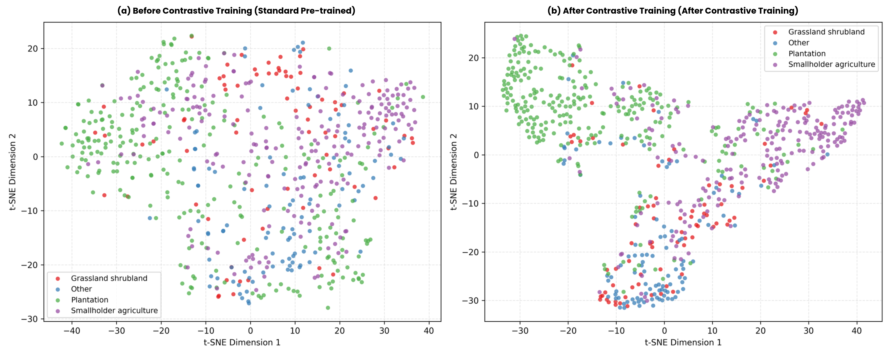
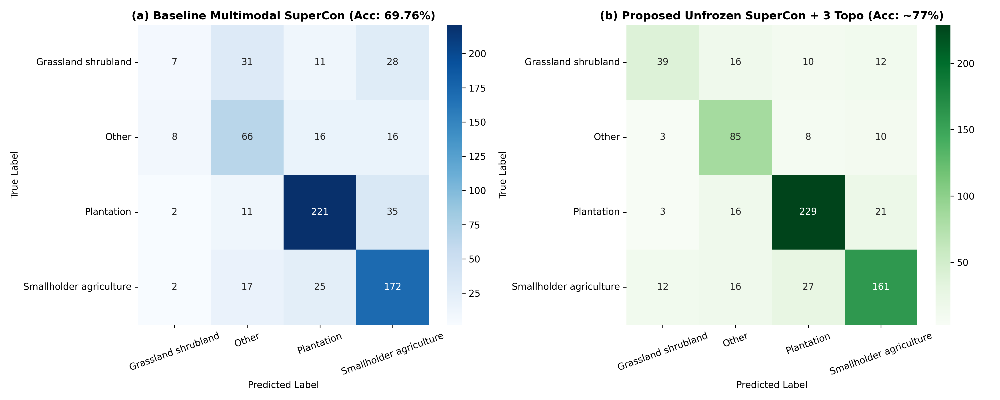
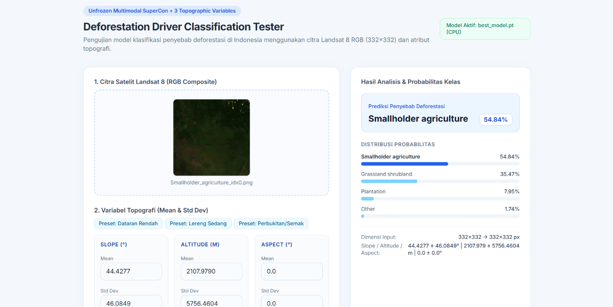

# Deforestation Driver Classification in Indonesia (Unfrozen Multimodal SuperCon)


Official implementation and web-based inference prototype for the research paper:
> **"The Effect of Contrastive Learning and Topographic Variables on Deforestation Driver Classification in Indonesia Using Landsat 8 Imagery"**

## Overview

Classifying deforestation drivers in Indonesia using Landsat 8 satellite imagery is challenging due to severe class imbalance and high visual similarity among land-cover classes. Prior Multimodal Supervised Contrastive Learning frameworks freeze the visual encoder during classifier fine-tuning and rely on static Focal Loss weights ($\alpha = 0.8$), causing low recall on minority classes such as *Grassland shrubland*.

This repository implements our proposed **Unfrozen Multimodal SuperCon** method with three key components:
1. **Stage 1 — Supervised Contrastive Pre-training:** EfficientNet-B2 backbone trained with Supervised Contrastive Loss ($\tau = 0.1$, 15 epochs, batch size 16) to separate intra-class and inter-class visual embeddings.
2. **Stage 2 — Unfrozen Multimodal Fine-Tuning:** Jointly fine-tunes the visual encoder ($\lambda_{enc} = 10^{-4}$) and MLP classifier ($\lambda_{cls} = 10^{-3}$) after concatenating the 1,408-dimensional visual representation with 6 auxiliary topographic descriptors (Slope, Altitude, and Aspect).
3. **Class-Balanced Focal Loss:** Replaces static scalar weighting with inverse class-frequency weights ($\gamma = 2.0$) to improve minority class recall without degrading majority class precision.

## Dataset

This study uses the public **ForestNet** dataset consisting of 2,757 annotated forest loss polygons across Indonesia captured by Landsat 8 (30 m resolution pan-sharpened to 15 m visible RGB composites at $332 \times 332$ pixels):

| Driver Class | Training Set | Validation Set | Testing Set | Total Samples |
| :--- | :---: | :---: | :---: | :---: |
| Plantation | 686 | 194 | 269 | 1,149 |
| Smallholder agriculture | 556 | 145 | 216 | 917 |
| Other | 231 | 83 | 106 | 420 |
| Grassland shrubland | 143 | 51 | 77 | 271 |
| **Total** | **1,616** | **473** | **668** | **2,757** |

## Experimental Results (Ablation Study)

Evaluated on the held-out ForestNet test set (668 samples):

| # | Scenario | Contrastive Stage | Auxiliary Predictors | Loss Function | Test Acc (%) | Macro Prec (%) | Macro Rec (%) | Macro F1 (%) |
| :-: | :--- | :---: | :--- | :--- | :---: | :---: | :---: | :---: |
| 1 | Image Only (0 Aux) | Yes (Frozen) | None | Focal ($\alpha=0.8$) | 69.46 | 59.31 | 58.65 | 56.35 |
| 2 | Image + 1 Topo | Yes (Frozen) | Slope | Focal ($\alpha=0.8$) | 69.76 | 62.47 | 58.57 | 56.71 |
| 3 | Image + 2 Topo | Yes (Frozen) | Slope, Altitude | Focal ($\alpha=0.8$) | 70.21 | 61.85 | 58.55 | 57.60 |
| 4 | Image + 3 Pure Topo | Yes (Frozen) | Slope, Alt, Aspect | Focal ($\alpha=0.8$) | 69.01 | 56.21 | 56.59 | 54.68 |
| 5 | Baseline (Image + 3 Topo + Gain) | Yes (Frozen) | 3 Topo + Gain | Focal ($\alpha=0.8$) | 70.36 | 61.32 | 59.95 | 59.29 |
| 6 | End-to-End (No SupCon) | No (Unfrozen) | Slope, Alt, Aspect | Focal ($\alpha=0.8$) | 75.15 | 72.52 | 69.37 | 69.99 |
| 7 | Frozen + Balanced Focal | Yes (Frozen) | Slope, Alt, Aspect | Balanced Focal | 69.31 | 60.88 | 60.50 | 60.55 |
| 8 | Unfrozen SuperCon | Yes (Unfrozen) | Slope, Alt, Aspect | Focal ($\alpha=0.8$) | 73.05 | 74.02 | 65.07 | 65.64 |
| **9** | **Proposed Method** | **Yes (Unfrozen)** | **Slope, Alt, Aspect** | **Balanced Focal** | **77.40** | **74.78** | **71.23** | **72.47** |

### Key Highlights
- **+7.04%** improvement in Test Accuracy and **+13.18%** in Macro F1-Score compared to the 4-auxiliary frozen baseline.
- Minority class (**Grassland shrubland**) recall increased more than fivefold, from **9.09%** (7/77) to **50.65%** (39/77).

### Visualizations

**t-SNE Feature Space (Before vs. After Contrastive Training)**


**Confusion Matrix Comparison (Baseline vs. Proposed)**


## Web Inference Prototype

A lightweight web application built with **FastAPI** and **PyTorch** is included for interactive testing on Landsat 8 composite imagery and auxiliary topographic descriptors.



### Project Structure

```text
journal-deforestation/
├── assets/             # Result plots & UI screenshots
├── checkpoints/        # Trained PyTorch checkpoint (.pt)
├── notebooks/          # Google Colab training & evaluation notebook
├── results/            # Ablation study metrics (CSV)
├── static/             # Frontend HTML/Tailwind CSS testing interface
├── app.py              # FastAPI backend & EfficientNet-B2 inference pipeline
└── requirements.txt    # Python dependencies
```

### Quick Start (Local Testing)

1. **Clone the repository**
   ```bash
   git clone [https://github.com/wannabegr3at/journal-deforestation.git](https://github.com/wannabegr3at/journal-deforestation.git)
   cd journal-deforestation
   ```

2. **Install dependencies**
   ```bash
   pip install -r requirements.txt
   ```

3. **Run the FastAPI server**
   ```bash
   python -m uvicorn app:app --reload --port 8000
   ```

4. **Open in browser**
   Access `http://127.0.0.1:8000`, upload a Landsat 8 RGB composite image, set the auxiliary descriptors, and click **Jalankan Klasifikasi Model**.

## Authors

- **Naufal Aqil Hidayat** — Department of Informatics, Universitas Bina Sarana Informatika
- **Muhammad Rafli** — Department of Informatics, Universitas Bina Sarana Informatika
- **Andre Saputra** — Department of Informatics, Universitas Bina Sarana Informatika
- **Jordy Lasmana Putra** — Department of Informatics, Universitas Bina Sarana Informatika
- **Zulfati Dinul Fatihah** — Department of Informatics, Universitas Bina Sarana Informatika
- **Musriatun Napiah** — Department of Informatics, Universitas Bina Sarana Informatika

## Citation

If you use this code or model checkpoint in your research, please cite:

```bibtex
@article{hidayat2026deforestation,
  title={The Effect of Contrastive Learning and Topographic Variables on Deforestation Driver Classification in Indonesia Using Landsat 8 Imagery},
  author={Hidayat, Naufal Aqil and Rafli, Muhammad and Saputra, Andre and Putra, Jordy Lasmana and Fatihah, Zulfati Dinul and Napiah, Musriatun},
  year={2026}
}
```
